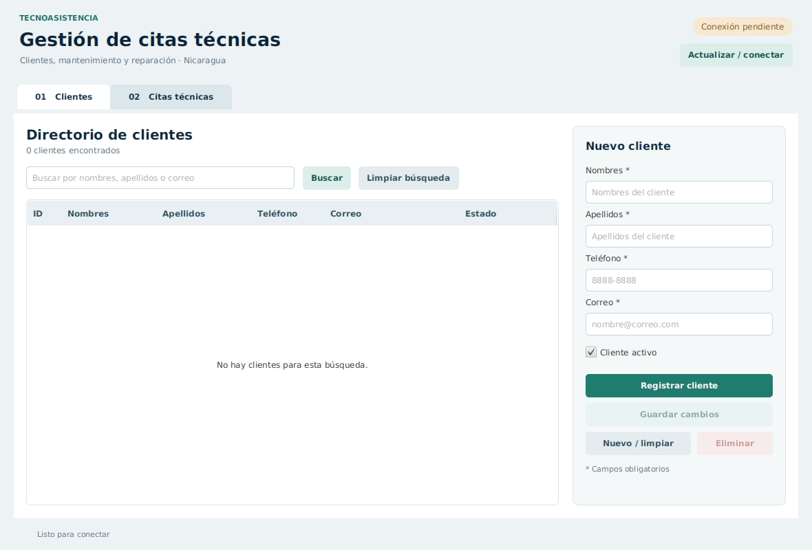
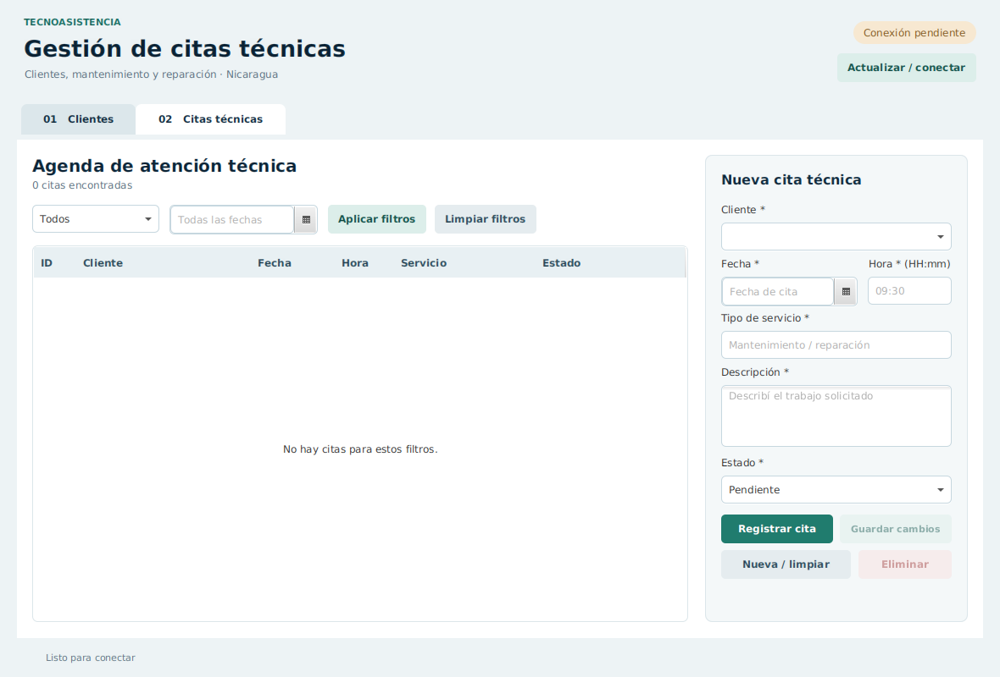

# Evaluacion_JavaFX_CitasTecnicas

Sistema de gestión de clientes y citas de **TecnoAsistencia Nicaragua S.A.**
UAM — Programación de Aplicaciones de Escritorio. Docente: José A. Durán García.
Evaluación de 30 puntos. Período exigido: **12–15 de octubre de 2026**.

## Equipo y responsabilidades

| Integrante | Usuario GitHub | Rama de trabajo | Responsabilidad |
|---|---|---|---|
| Rolando Enrique Mayorga Mena | `Rolando8-03` | `rolando/base-jdbc` | SQL, conexión JDBC, menú principal e integración |
| Mauro Engelbert Delgado Saenz | masodel | `mauro/clientes` | Modelo, DAO, formulario, búsqueda y CRUD de clientes |
| Aris Gavarrete | Arisgav | `aris/citas` | Modelo, DAO, formulario, relación y filtros de citas |
| Dylan Mora | moraditoo | `dylan/pruebas` | Validaciones, alertas, pruebas, documentación y capturas |

Los nombres provienen de los integrantes indicados y los trabajos previos del equipo.
Rolando8-03 está confirmado. Completar los **usuarios reales de Mauro, Aris y Dylan**.
Repositorio del equipo: **PENDIENTE: pegar enlace real**.
Cada persona debe aportar cambios sustantivos propios y poder defenderlos.

- [Qué hace cada integrante](src/main/java/ni/edu/uam/citastecnicas/docs/RESPONSABILIDADES.md).
- [Ramas, commits y pull requests](src/main/java/ni/edu/uam/citastecnicas/docs/GIT_EQUIPO.md).
- [Revisión de todos los requisitos](src/main/java/ni/edu/uam/citastecnicas/docs/REVISION_REQUISITOS.md).
- [Pruebas, defensa y capturas](src/main/java/ni/edu/uam/citastecnicas/docs/DEFENSA_Y_CAPTURAS.md).
- [Verificación realizada y pendientes](src/main/java/ni/edu/uam/citastecnicas/docs/VERIFICACION.md).

## Tecnologías y nivel del código

Java **21**, JavaFX **21.0.6**, Maven, FXML, CSS y PostgreSQL mediante JDBC directo.
Proyecto no modular, sin Lombok ni ORM. Todos los contenedores del FXML son **AnchorPane**;
la navegación usa dos botones y visibilidad de los formularios.

El código usa clases, constructores, getters, arreglos/listas, ciclos, if/else, métodos,
lambdas de eventos y propiedades JavaFX. Para JDBC: Connection, Statement,
PreparedStatement, ResultSet, SQLException y try-with-resources, **exigidos en la guía**.
Las operaciones en segundo plano usan **Thread, Runnable, interrupt y Platform.runLater**,
como en la práctica de hilos. No hay Task, ExecutorService, Callable, Consumer, record,
streams, patrones de instanceof, switch con flechas, JUnit ni pruebas con reflexión.

El nivel se ajustó a los ejemplos y trabajos que se pudieron recuperar; no se dispone
literalmente de todas las explicaciones orales del curso.

## Funcionalidades

- CRUD completo de clientes y citas con selección en TableView y actualización de tablas.
- Búsqueda parcial de nombres, apellidos o correo sin distinguir mayúsculas.
- ComboBox con clientes existentes y nombre completo visible en la tabla de citas.
- Filtros de estado, fecha o ambos; botón para limpiar ambas condiciones.
- Confirmación antes de **eliminación física**.
- Rechazo de eliminación de clientes con citas por FK `ON DELETE RESTRICT`.
- Persistencia en PostgreSQL al cerrar y volver a abrir.
- Interfaz receptiva mientras se ejecutan consultas; bloqueo de botones durante cada operación
  para evitar dobles clics y operaciones simultáneas desde la misma ventana.

`activo` es un dato editable, no reemplaza DELETE. La guía no prohíbe asociar una cita
con un cliente inactivo, ni fechas pasadas: no se agregaron esas restricciones.

## Validaciones

| Dato / operación | Comprobación |
|---|---|
| Todos los campos obligatorios | null, vacíos, espacios e invisibles sin contenido |
| Texto | Longitud según VARCHAR; caracteres de control no válidos rechazados |
| Nombres y apellidos | Letras/tildes, espacios, punto, apóstrofo y guion; máximo 80 |
| Teléfono | Máximo 20 caracteres; 7–15 dígitos; separadores habituales, + inicial y paréntesis correctos |
| Correo | Formato básico, máximo 120, parte local hasta 64; puntos/dominio revisados |
| Correo repetido | Consulta con parámetros al insertar/editar; excluir propio ID; guardar correo en minúsculas; UNIQUE en PostgreSQL |
| Fecha | Obligatoria, calendario no editable, año 1–9999 |
| Hora | HH:mm, de 00:00 a 23:59, precisión de minutos |
| Servicio / descripción | Obligatorios, máximo 80 / 255 |
| Estado | Solo Pendiente, En proceso, Finalizada y Cancelada |
| Selección / ID | No editar/eliminar sin selección; IDs positivos en DAO; aviso si el registro ya desapareció |
| Cliente de una cita | Selección existente en ComboBox y FK comprobada por PostgreSQL |
| Eliminación | Confirmación; Cancelar es el botón predeterminado; cliente con citas protegido |
| SQL | Valores siempre parametrizados; búsqueda trata % y _ del usuario como texto literal |
| Conexión y errores | Mensajes de autenticación, base inexistente, tablas, permisos, duplicados y restricciones; sin mostrar contraseña |

La comprobación de correo en DAO también detecta correos anteriores escritos con otras
mayúsculas. La aplicación siempre escribe el correo en minúsculas, de modo que UNIQUE
protege también dos altas simultáneas desde la aplicación. Quien escriba directamente
por fuera de ella debe respetar esta normalización; UNIQUE compara el valor almacenado.
El formato validado es básico, como pide la guía; no pretende cubrir toda la norma internacional del correo.

## Instalación en PostgreSQL

1. Conectado a **postgres** en pgAdmin, ejecutar **solo**:

   ```sql
   CREATE DATABASE gestion_citas;
   ```

   Fuera de una transacción, con autocommit. Omitir si ya existe.
2. Abrir otra Query Tool conectada a **gestion_citas**.
3. Abrir `../../Desktop/Evaluacion_JavaFX_CitasTecnicas/gestion_citas.sql` y ejecutar desde `BEGIN;` hasta `COMMIT;`.
4. Ejecutar los SELECT finales; deben mostrar gestion_citas y las dos tablas.

**No ejecutar todo el archivo en una sola conexión.** PostgreSQL usa **SERIAL** para
el ID automático que la guía llama AUTO_INCREMENT. El script no borra datos existentes.
`IF NOT EXISTS` no modifica un esquema antiguo incompatible; comprobar las columnas
si se usa una base previa. Si falla un bloque, ejecutar `ROLLBACK;`, corregir y repetir.

## Credenciales locales

Copiar `../../Desktop/Evaluacion_JavaFX_CitasTecnicas/conf/db.properties.example` como **conf/db.properties**. En PowerShell:

```powershell
Copy-Item conf/db.properties.example conf/db.properties
```

Editar esa copia en tu computadora:

```properties
 db.url=jdbc:postgresql://localhost:5432/gestion_citas
 db.user=postgres
 db.password=TU_CLAVE_LOCAL
```

No usar literalmente TU_CLAVE_LOCAL: ingresar tu contraseña. El archivo local está
ignorado por Git. No hay una contraseña de PostgreSQL universal. En Java Properties,
una barra inversa en una contraseña se escribe doble (`\\`).
También se aceptan DB_URL, DB_USER y DB_PASSWORD; si están definidas, tienen prioridad.
Quitar variables antiguas si interfieren con la configuración.

```bash
 git check-ignore conf/db.properties
 git status --short
```

## Ejecución en IntelliJ

1. Descomprimir y abrir la carpeta que contiene **pom.xml** como proyecto Maven.
2. Elegir JDK **21** en Project SDK y en Maven Runner.
3. Esperar a que Maven descargue JavaFX y el driver PostgreSQL. Requiere internet la primera vez.
4. Crear la base/tablas y completar la configuración local.
5. Ejecutar el main de **Launcher.java**.
6. En Run → Edit Configurations, Working directory debe ser la carpeta de pom.xml y conf/.

También desde terminal, con Maven 3.9+ y Java 21:

```bash
mvn clean javafx:run
```

Al abrir, intenta cargar datos reales. Si falla, corregir credenciales y usar
**Actualizar / conectar**. No hay login ni datos simulados en la aplicación.

## Uso

**Clientes:** llenar campos → Registrar cliente. Seleccionar fila para editar y
Guardar cambios. Nuevo / limpiar prepara un alta nueva. Buscar o presionar Enter
consulta los datos; Limpiar búsqueda recupera todos.

**Citas:** elegir cliente, fecha, hora, servicio, descripción y estado → Registrar cita.
Seleccionar fila para modificar todos sus campos. Para finalizar, elegir Finalizada
→ Guardar cambios. Elegir los filtros de arriba → Aplicar filtros; Limpiar filtros
recupera todas. Si un registro guardado no coincide con los filtros, limpiar para verlo.

## Estructura y JDBC para la defensa

| Archivo | Qué contiene |
|---|---|
| gestion_citas.sql | cliente, cita_tecnica, PK, UNIQUE, NOT NULL, FK y estados CHECK |
| db/ConexionDB.java | Credenciales locales, Connection y Statement fijo SELECT 1 |
| dao/ClienteDAO.java | INSERT, SELECT, UPDATE, DELETE y búsqueda parametrizada |
| dao/CitaTecnicaDAO.java | CRUD, JOIN de cliente y filtros opcionales con parámetros |
| model/Cliente.java y CitaTecnica.java | Datos, constructores y getters |
| controller/ClienteController.java y CitaController.java | Formularios, selección y eventos |
| controller/MainController.java | Navegación, Thread/Runnable, runLater y recarga |
| util/Validacion.java y Alertas.java | Reglas compartidas y mensajes claros |
| src/main/resources/fxml | Tres FXML con AnchorPane |
| src/main/resources/css | Apariencia |
| src/test/java | Dos programas sencillos de pruebas con main |

Todas las conexiones, sentencias y resultados se cierran mediante try-with-resources.
Cada escritura es una sentencia atómica. La FK protege al cliente incluso si lo intenta
borrar otro programa. No se concatenan entradas del usuario en SQL: el armado del filtro
solo añade fragmentos fijos y usa `?` para los valores.

## Pruebas sencillas, sin frameworks

**Compilar todo (incluidos los programas de prueba):**

```bash
mvn clean test-compile
```

Este comando compila; **no ejecuta automáticamente** los main de pruebas.

**Validaciones:** en IntelliJ, ejecutar `PruebasValidacion.main()` desde src/test/java.
No requiere PostgreSQL. Debe imprimir el número de comprobaciones correctas.

**CRUD real:** crear una base separada **gestion_citas_pruebas**, aplicar allí el bloque
BEGIN…COMMIT de gestion_citas.sql. En la configuración de ejecución de
`PruebasPostgreSQL.main()` establecer:

```text
DB_URL=jdbc:postgresql://localhost:5432/gestion_citas_pruebas
DB_USER=postgres
DB_PASSWORD=tu contraseña local
```

No subir esas variables/contraseña al repositorio. La prueba se detiene si la base no
es exactamente gestion_citas_pruebas; crea registros propios, prueba duplicados al
insertar/editar, ambos CRUD, filtros, FK y persistencia entre conexiones, y los elimina
al terminar. No reemplaza la prueba manual de cerrar/abrir la aplicación.

## Capturas

Estas dos capturas muestran la interfaz cargada **sin conectar**. No prueban persistencia.




Añadir aquí las capturas reales de las pruebas de [DEFENSA_Y_CAPTURAS.md](src/main/java/ni/edu/uam/citastecnicas/docs/DEFENSA_Y_CAPTURAS.md):
cliente, duplicado, edición, cita, búsqueda, filtros, Finalizada, rechazo de eliminación,
persistencia, eliminación e historial. Registrar también el resultado observado y el autor.

## Git, fechas y entrega

Repositorio único **Evaluacion_JavaFX_CitasTecnicas**, público o con acceso del docente.
Máximo cuatro estudiantes; este equipo tiene cuatro. README con nombres y cuentas reales.
Cada integrante debe tener al menos un commit sustantivo propio entre el 12 y el 14;
el repositorio necesita **al menos dos commits sustantivos cada día 12, 13 y 14**.
El último commit evaluable será el disponible al revisar el docente el día de defensa.

Este ZIP no contiene un historial atribuido a ustedes. Conservar avances anteriores;
no crear autores, fechas ni commits vacíos. Si faltan avances de fechas pasadas,
un commit nuevo no los reemplaza. Consultar [GIT_EQUIPO.md](src/main/java/ni/edu/uam/citastecnicas/docs/GIT_EQUIPO.md).

## Problemas frecuentes

| Síntoma | Revisar |
|---|---|
| Error de autenticación | Usuario/contraseña y conexión en pgAdmin |
| Base inexistente | gestion_citas y db.url |
| Faltan tablas/columnas | Script aplicado en la base correcta |
| Maven no descarga | Internet/proxy y recarga del proyecto Maven |
| Java 21 no soportado | JDK 21 también en Maven Runner |
| No encuentra conf o FXML | Abrir proyecto completo y Working directory correcto |
| Cliente no se elimina | Tiene citas; eliminar primero citas con confirmación |
| Registro no aparece | Limpiar búsqueda/filtros y actualizar |

Referencia académica: Evaluacion_Practica_JavaFX_JDBC_CitasTecnicas.docx.
Documentación técnica: [OpenJFX](https://openjfx.io/openjfx-docs/) y
[pgJDBC](https://jdbc.postgresql.org/documentation/).
